# 🌅 My Day AI

[](https://github.com/vukasin-knezevic/my-day-ai/actions/workflows/ci.yml)
[](https://vukasin-knezevic.github.io/my-day-ai/)

**[👉 Live demo: vukasin-knezevic.github.io/my-day-ai](https://vukasin-knezevic.github.io/my-day-ai/)** · **[English](#english) · [Srpski](#srpski)**

<p align="center">
  
  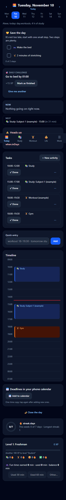
  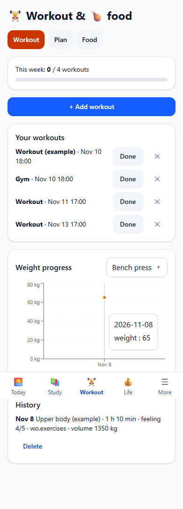
</p>

---

## English

> I conceived and designed this app; I wrote the code with Claude Code.

I started building it as a student, for my own day: so that classes, exams, workouts and sleep would stop being scattered across calendars, chats and my head. Then I turned it into a general app that **any student** can use: you set your own daily rhythm, goals, reward and language.

**My Day AI** is a day planner for students: classes, exams, workouts, nutrition, sleep, money and habits in one place. It is a mobile-first PWA that installs on a phone or laptop and works offline (except the AI part). It is available in Serbian (Latin and Cyrillic), English, French, Spanish, German and Russian.

### Versions

Until the official release every version is **0.x**: **0.1** (the first complete app), **0.2** (the general version, overnight fixes and a code review), **0.3** (fixes after the first real use on a phone, new settings, iPhone), **0.4** (data safety, “Back” and calendar on the phone, a workout as one thing, a guided tour, a morning routine, a daily challenge and “Close the day”; built with Claude Code from a task file I wrote, model: _[author fills in]_), **0.4.3** (a swipeable bottom bar with Settings pinned on the right; the app asks only for your name and works out Serbian grammar by itself). **1.0** is reserved for the first official release (colleagues + Google Play).

### User testing

The app was tested by **two testers** on two different phones. A tester tests and reports, and writes no code; every remark went into the task file for the next version.

- **Vukašin (Android)**: after version 0.3 the remarks from a real phone were written down. Because of them: a tap on a notification opens the app, with no duplicate notifications and with the logo in the status bar; the Back button and gesture work through the whole flow; a day picker on the Today screen; one shared “Deleted · Undo” for every delete.
- **Andrea Jovović (iPhone)**, a student at the Faculty of Media and Communications (named with her permission): because of her, content no longer runs under the clock and battery, “Add to calendar” is on the Study and Today screens and opens Safari’s “Add all”, slots and obligations look saved, a workout is one thing (day, time, reminder), “Back” works by swiping from the left edge, and an **interactive tutorial** was made, because it was not clear to her what the app is for.

### The problem

A student juggles lectures, exams with registration deadlines, workouts, fun and sleep, all scattered. The most common and costly mistake is simple: **forgetting to register for an exam**. The app puts that in red on the first screen and builds the rest of the day around the obligations.

### Features

- 🌅 **Today**: day timeline from wake-up to bedtime, one-click done/skip, **add and edit activities** (also repeating ones: daily, weekdays, weekly), alerts (unregistered exam, deadline tomorrow, low sleep) and a **one-line quick entry** ("tomorrow study math 2h", "coffee 200", "slept 1:30"), works without AI.
- 📚 **Study**: subjects, weekly timetable with a **going / skipping / sometimes** question per slot (skipped slots become free time), exams with colored countdown, a **registration checklist** for the current month, points and grade estimate.
- 🧠 **Rule-based planner** (`planWeek`): study blocks before exams (harder and closer = earlier and more), breaks, nothing before wake-up or after bedtime, at least one easy day, a shortened workout on the exam eve (with an explanation), your reward after studying. Suggestions have a dashed border until accepted.
- 🤖 **AI (Claude)**: day/week plan, chat, weekly summary, smart entry, exam schedule import from pasted text, workout plan. Every answer is **validated with `zod`** before it is shown; the assistant's tone adapts (friendly / strict / supportive). Prompts and answers use the selected language.
- 🏋️ **Workouts & nutrition**: sets × reps × weight, progress chart, automatic **personal records**, ready-made splits and **your own workout templates**, daily protein goal.
- 😴💰✅ **Sleep, money, habits**: bed/wake with two clicks, 7-day average, bedtime suggestion; budget per category with an 80% warning (your currency); habits with day streaks.
- ☀️ **Morning routine, daily challenge, “Close the day”**: 3–5 small steps in the morning (with a notification and, on Android, a “Done” button), one small challenge a day chosen from your own data, and three short steps in the evening that close the day (review, mood, the main thing for tomorrow). No blame: a missed day offers a short version, and the streak has saves ❄️.
- 🧭 **Guided tour**: a walk through the real screens (about a minute), the sample things are deleted at the end; again under Settings → “How the app works”.
- 🏆 **Achievements**: badges, personal records, the week ring and surprises 🎁 (at most two a day; sound, vibration and animations can be switched off).
- 🎁 **Motivation**: XP, levels, streaks 🔥 and **a reward you name yourself** (gaming time, an episode of a series, a night out…) earned by studying. The app only counts it, no judging.
- 🔔 **Reminders + “Add to calendar”**, 📊 **week/month overview**, 💾 **JSON export/import** (without the API key), dark theme, keyboard shortcuts (`N`, `T`, `W`, `/`, `?`; `Enter` confirms, `Esc` cancels).

### Screenshots

<p align="center">
  
  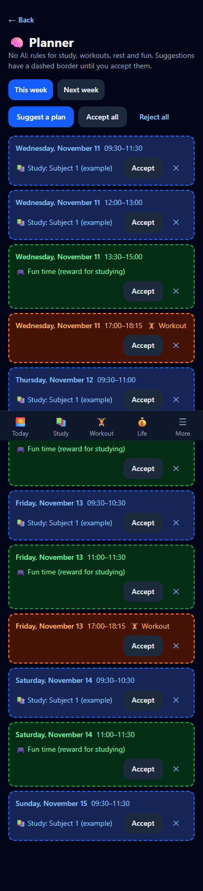
  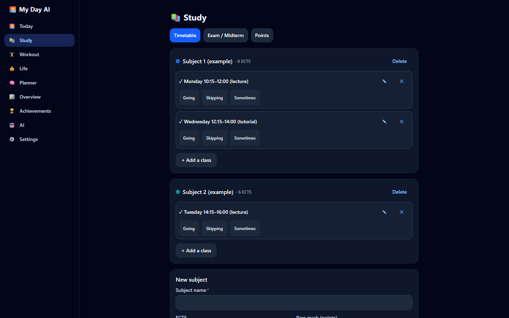
</p>

### Languages

Serbian (Latin), Serbian (Cyrillic), English, French, Spanish, German and Russian (the last four were not reviewed by native speakers). Pick the language in the first onboarding step and change it any time under **Settings → Appearance → Language**. By default the browser language is used. Dates, weekday and month names and number formats follow the language, and so do the AI prompts and answers. The quick entry understands Serbian and English.

### How to add a language

One new file, no code changes:

1. Copy `src/i18n/locales/en.ts` to `src/i18n/locales/<code>.ts` (e.g. `de.ts`).
2. Translate the texts (right-hand side), then set `code`, `name` (the language's name in that language) and `dateLocale` (from `date-fns/locale`). Keep the `{placeholders}`; plural forms are keys ending in `.one`, `.few` and `.other`.
3. Add a line with the same `code` and `name` to `src/i18n/languageList.ts` (languages are loaded only when needed, so the picker must not download them all).
4. Run `npm test`: the failing test names the missing key or `{placeholder}`, or tells you that the list does not match the files. Once it passes, the language is in the picker.

### Two AI modes

**Manual (free):** "Copy for Claude" builds a prompt with your week's data → paste it into claude.ai → answer 3–5 questions → paste the JSON reply back. **API (pay per use):** one click, called directly from the browser. You choose the mode during onboarding and can change it in the settings. Both modes use the **same** prompt builder, **same** `zod` validation and **same** preview. The API key is stored **only on your device** (visible in the browser's developer tools; never share it and set a spending limit in the Anthropic console).

### How to get an Anthropic API key (API mode only)

Manual mode needs no key. For API mode:

1. Create an account at [console.anthropic.com](https://console.anthropic.com) and sign in.
2. Under **Billing** add a payment method and set a monthly spending limit.
3. Open **API Keys** → **Create Key**, name it (e.g. "My Day AI") and **copy the key** (it starts with `sk-ant-`). It is shown only once.
4. In the app: **Settings → AI**: choose API mode and paste the key into **API key**. The key stays on that device only.

### Reminders: honest limits

No server means browser notifications on a phone only work reliably while the app is open or recently used. Use **Add to calendar**: the phone offers its Calendar app straight away, and the calendar then reminds you by itself.

### Tech stack

Vite, React 18, TypeScript (strict), Tailwind CSS, Zustand + IndexedDB, React Router (hash), an i18n layer with date-fns locales and `Intl`, Recharts, zod, Vitest + Testing Library, Playwright + axe, vite-plugin-pwa.

### Run & test

```bash
npm install && npm run dev
npm run lint && npm run typecheck && npm test
npx playwright install chromium && npm run e2e
```

### Project structure

```
src/
  types.ts            all data types
  store.ts            Zustand + IndexedDB
  i18n/               translations (locales/*.ts), t(), language choice
  lib/                pure logic without React (tested)
    quickParse.ts     one-line quick entry (Serbian and English)
    planner.ts        planWeek()
    schedule.ts       what is on the schedule, warnings
    grades.ts exams.ts workout.ts life.ts xp.ts overview.ts ...
    ai/               prompt, client, JSON extraction, zod schemas (API and manual mode)
  pages/              screens
  components/         shared UI (NumberInput, KeyScope, ...)
e2e/                  Playwright tests
docs/                 ARCHITECTURE.md, SMARTWATCH.md, development/, screenshots/
```

Details: [docs/ARCHITECTURE.md](docs/ARCHITECTURE.md). Notes on sleep data from smartwatches: [docs/SMARTWATCH.md](docs/SMARTWATCH.md). How the project came to be: [docs/development/](docs/development/README.md).

### Deployment

Published automatically to GitHub Pages on every push to `main`.

### License

MIT, see [LICENSE](LICENSE).

---

## Srpski

<p align="center">
  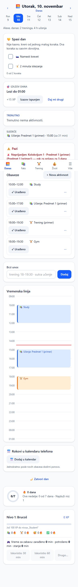
  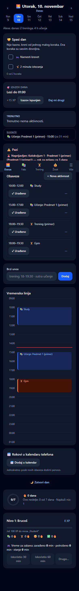
  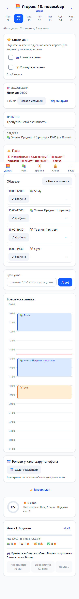
</p>

> Aplikaciju sam osmislio i dizajnirao ja, a kod sam pisao uz Claude Code.

Počeo sam da je pravim kao student, za svoj dan: da faks, kolokvijumi, trening i san ne budu razbacani po kalendaru, porukama i glavi. Posle sam je pretvorio u opštu aplikaciju koju može da koristi **svaki student**: ti sam podešavaš ritam dana, ciljeve, nagradu i jezik.

**My Day AI** je planer dana za studente: faks, kolokvijumi, trening, ishrana, san, novac i navike na jednom mestu. Radi na telefonu i laptopu, instalira se kao aplikacija (PWA) i radi offline (osim AI dela). Dostupna je na srpskom (latinica i ćirilica), engleskom, francuskom, španskom, nemačkom i ruskom.

### Verzije

Do zvanične objave sve verzije su **0.x**: **0.1** (prva cela aplikacija), **0.2** (opšta verzija, noćne popravke i pregled koda), **0.3** (popravke posle prvog stvarnog korišćenja na telefonu, nova podešavanja, iPhone), **0.4** (sigurnost podataka, „Nazad“ i kalendar na telefonu, trening kao jedna stvar, tutorijal, jutarnja rutina, dnevni izazov i „Zatvori dan“; rađena uz Claude Code iz zadatka koji sam napisao, model: _[upisuje autor]_). Verzija **1.0** je rezervisana za prvu zvaničnu objavu (kolege + Google Play).

### User testing

Aplikaciju su testirala **dva testera**, na dva različita telefona. Tester testira i javlja, ne piše kod; svaka primedba je ušla u zadatak za sledeću verziju.

- **Vukašin (Android)**: posle verzije 0.3 su zapisane primedbe sa pravog telefona. Zbog njih: dodir na notifikaciju otvara aplikaciju, bez duplih notifikacija i sa logotipom u statusnoj traci; dugme i gest „Nazad“ rade kroz ceo tok; izbor dana na ekranu Danas; jedno „Obrisano · Poništi“ za sva brisanja.
- **Andrea Jovović (iPhone)**, studentkinja Fakulteta za medije i komunikacije (ime je navedeno uz njenu dozvolu): zbog nje sadržaj više ne prolazi ispod sata i baterije, „Dodaj u kalendar“ je na ekranu Faks i Danas i otvara Safari „Dodaj sve“, termini i obaveze izgledaju sačuvano, trening je jedna stvar (dan, vreme, podsetnik), „Nazad“ radi prevlačenjem od leve ivice, i napravljen je **interaktivni tutorijal**, jer joj nije bilo jasno čemu aplikacija služi.

### Problem koji rešava

Student ima predavanja, kolokvijume sa rokovima za prijavu, trening, zabavu i san, a sve to je razbacano. Najveći rizik je banalan: **zaboraviš da prijaviš kolokvijum**. Aplikacija zato to stavlja crveno na prvi ekran, a ostatak dana slaže oko obaveza.

### Funkcije

- 🌅 **Danas**: vremenska linija od buđenja do spavanja, „urađeno / preskoči" jednim klikom, **dodavanje i izmena aktivnosti** (i ponavljajućih: svaki dan, radnim danima, nedeljno), upozorenja (neprijavljen kolokvijum, rok sutra, malo sna) i **brzi unos rečenicom** („sutra učenje mata 2h", „kafa 200", „legao 1:30" ili „gym tomorrow 18-19:30", „coffee 200", „slept 1:30"), čak i bez AI-ja.
- 📚 **Faks**: predmeti, nedeljni raspored uz pitanje **idem / ne idem / ponekad** (termini „ne idem" postaju slobodno vreme), kolokvijumi sa odbrojavanjem u boji, **čeklista prijava** za tekući mesec, poeni, ocena i koliko fali do prolaza.
- 🧠 **Planer bez AI-ja** (`planWeek`): raspoređuje učenje pre kolokvijuma (teži i bliži rok = ranije i više), blokovi sa pauzom, ništa pre buđenja ni posle spavanja, bar jedan lakši dan, dan pred kolokvijum skraćuje trening i objašnjava zašto, nagradu nudi posle učenja. Predlozi imaju isprekidanu ivicu dok ih ne prihvatiš.
- 🤖 **AI (Claude)**: plan dana i nedelje, chat asistent, rezime nedelje, pametan unos, uvoz rasporeda kolokvijuma iz nalepljenog teksta, plan treninga. Odgovori se **validiraju `zod` šemama** pre prikaza, a ton asistenta se menja (drugarski / strog / podržavajući). Prompt i odgovori su na izabranom jeziku. Vidi [dva režima](#dva-ai-režima).
- 🏋️ **Trening i ishrana**: serije × ponavljanja × kilaža, grafikon napretka, automatski **lični rekordi 🎉**, gotovi splitovi i **sopstveni šabloni treninga**, dnevni cilj proteina.
- 😴💰✅ **San, novac, navike**: „Legao / Ustao", prosek sna, predlog vremena spavanja; budžet po kategoriji sa upozorenjem na 80% (valuta po izboru); navike sa nizom dana.
- ☀️ **Jutarnja rutina, dnevni izazov, „Zatvori dan“**: 3–5 malih koraka ujutru (sa notifikacijom i, na Androidu, dugmetom „Urađeno“), jedan mali izazov dnevno izabran iz tvojih podataka, i uveče 3 kratka koraka koji zatvaraju dan (pregled, raspoloženje, glavna stvar za sutra). Bez osude: propušten dan nudi kratku verziju, a niz ima „spasove“ ❄️.
- 🧭 **Tutorijal**: vođeni obilazak po pravim ekranima (oko minut), probne stvari se brišu na kraju; ponovo u Podešavanja → „Kako radi aplikacija“.
- 🏆 **Dostignuća**: značke, lični rekordi, prsten nedelje i iznenađenja 🎁 (najviše dva dnevno; zvuk, vibracija i animacije mogu da se isključe).
- 🎁 **Motivacija**: XP, nivoi (Brucoš → Diplomac), nizovi 🔥 i **nagrada koju sam biraš** (npr. vreme za igrice, epizoda serije, izlazak) koju zarađuješ učenjem. Aplikacija je samo broji, bez zamerki.
- 🔔 **Podsetnici i pregled**: notifikacije pregledača + **„Dodaj u kalendar“**, pregled nedelje i meseca sa grafikonima.
- 💾 Izvoz/uvoz svih podataka (JSON, bez API ključa), tamna tema, prečice na tastaturi (`N`, `T`, `W`, `/`, `?`; `Enter` potvrđuje, `Esc` otkazuje).

### Izgled

<p align="center">
  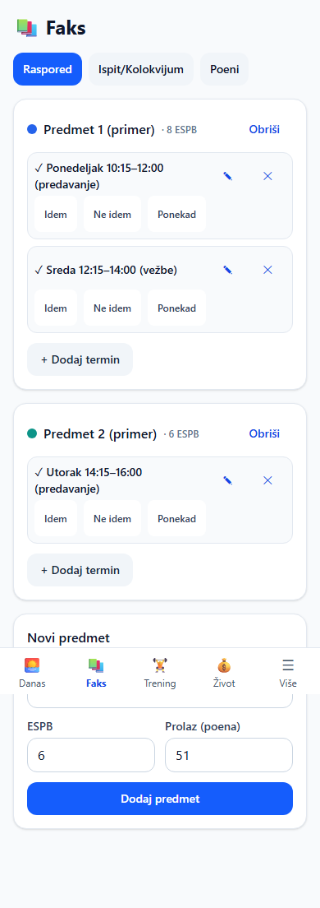
  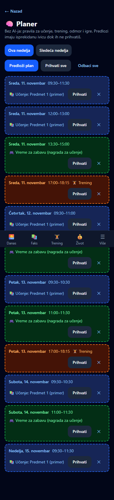
  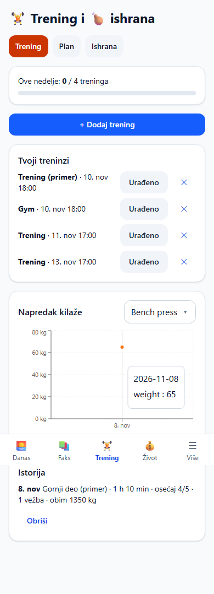
</p>
<p align="center">
  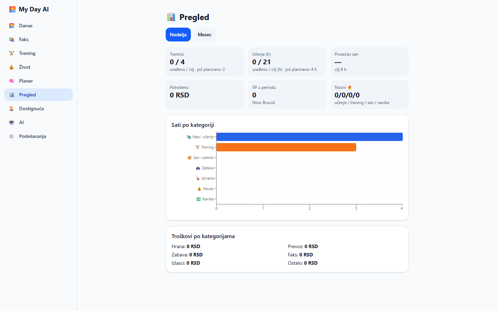
  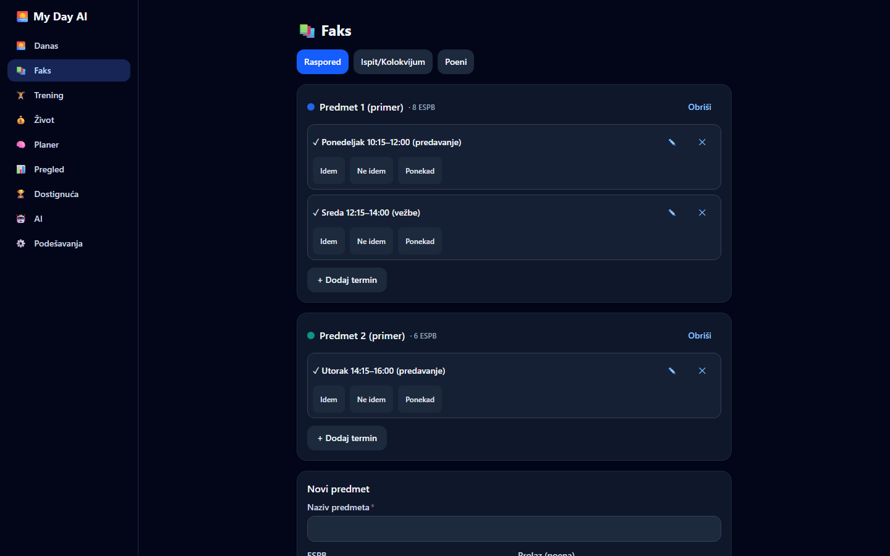
</p>

Sve slike su u [`docs/screenshots/`](docs/screenshots/): telefon i laptop, svetla i tamna tema, srpski i engleski (i ćirilica).

### Jezici

Aplikacija je prevedena na **srpski (latinica)**, **srpski (ćirilica)**, **engleski**, **francuski**, **španski**, **nemački** i **ruski**. Prevodi na engleski, francuski, španski, nemački i ruski nisu prošli izvornog govornika. Jezik biraš u prvom koraku podešavanja pri prvom pokretanju, a kasnije u **Podešavanja → Izgled → Jezik**. Podrazumevano se uzima jezik pregledača. Datumi, nazivi dana i meseci i format brojeva prate izabrani jezik, a AI prompt i odgovori takođe. Brzi unos razume srpski i engleski.

### Kako dodati jezik

Dodavanje jezika je **samo jedan novi fajl**, bez menjanja koda:

1. Kopiraj `src/i18n/locales/en.ts` u `src/i18n/locales/<kod>.ts` (npr. `de.ts`).
2. U novom fajlu prevedi tekstove (desna strana), postavi `code`, `name` (naziv jezika na tom jeziku) i `dateLocale` (iz `date-fns/locale`). Ostavi `{parametre}` na svom mestu; oblici množine su ključevi sa `.one`, `.few` i `.other`.
3. Dodaj red sa istim `code` i `name` u `src/i18n/languageList.ts` (jezici se učitavaju tek kad su potrebni, pa izbor jezika ne sme da ih sve preuzme).
4. Pokreni `npm test`: test koji pada tačno kaže koji ključ ili `{parametar}` fali ili da lista ne odgovara fajlovima. Kad prođe, jezik je u izboru jezika.

### Dva AI režima

|      | 📋 Ručni (besplatno)                                                                                           | 🤖 API (plaća se po upotrebi)                      |
| ---- | -------------------------------------------------------------------------------------------------------------- | -------------------------------------------------- |
| Cena | besplatno                                                                                                      | plaća se po upotrebi (prikazana procena potrošnje) |
| Kako | „Kopiraj za Claude" → nalepiš u [claude.ai](https://claude.ai) → odgovoriš na 3–5 pitanja → nalepiš JSON nazad | jedan klik, poziv ide direktno iz pregledača       |
| Kod  | **isti** prompt, **ista** `zod` provera i **isti** prikaz                                                      |                                                    |

Režim biraš u onboardingu, a možeš da ga promeniš u podešavanjima. Ključ se čuva **samo lokalno** u pregledaču tog uređaja; vidljiv je u alatima pregledača, zato ga nikome ne deli i postavi mesečni limit potrošnje u Anthropic konzoli.

### Kako da dobiješ Anthropic API ključ (samo za API režim)

Ručni režim ne traži ključ. Za API režim:

1. Napravi nalog na [console.anthropic.com](https://console.anthropic.com) i prijavi se.
2. U **Billing** dodaj način plaćanja i postavi mesečni limit potrošnje.
3. Otvori **API Keys** → **Create Key**, daj mu ime (npr. „My Day AI") i **kopiraj ključ** (počinje sa `sk-ant-`). Prikazuje se samo jednom.
4. U aplikaciji: **Podešavanja → AI**: izaberi API režim i nalepi ključ u polje **API ključ**. Ključ ostaje samo na tom uređaju.

### Podsetnici: šta radi, a šta ne

Nema servera, pa notifikacije na telefonu rade pouzdano samo dok je aplikacija otvorena ili nedavno korišćena. Zato postoji **„Dodaj u kalendar“**: telefon odmah ponudi Kalendar i on će sam podsećati.

### Tehnologije (i zašto)

| Alat                                       | Zašto                                                              |
| ------------------------------------------ | ------------------------------------------------------------------ |
| Vite + React 18 + TypeScript (strict)      | brz razvoj, komponente, tipovi hvataju greške pre pokretanja       |
| Tailwind CSS                               | konzistentan dizajn, tamna tema, mobile-first                      |
| Zustand + IndexedDB (`idb-keyval`)         | jednostavno stanje koje preživi zatvaranje aplikacije, bez servera |
| React Router (hash)                        | radi na statičkom hostingu (GitHub Pages)                          |
| i18n sloj + date-fns locale + `Intl`       | jezici kao fajlovi prevoda, datumi i brojevi po jeziku             |
| Recharts                                   | grafikoni                                                          |
| zod                                        | provera AI odgovora (model može da vrati loš JSON)                 |
| Vitest + Testing Library, Playwright + axe | unit, komponentni i e2e testovi, provera pristupačnosti            |
| vite-plugin-pwa                            | instalacija na telefon i rad offline                               |

### Pokretanje

```bash
npm install
npm run dev          # http://localhost:5173 (i adresa za telefon na istoj Wi-Fi mreži)
```

### Testovi

```bash
npm run lint && npm run typecheck
npm test                 # unit + komponente (Vitest), prevodi i pravila planera na 300 nasumičnih nedelja
npm run test:coverage    # pokrivenost src/lib
npx playwright install chromium   # jednom
npm run e2e              # end-to-end + axe pristupačnost
SCREENSHOTS=1 npx playwright test screenshots   # nove slike u docs/screenshots
```

### Struktura

```
src/
  types.ts            svi tipovi podataka
  store.ts            Zustand + IndexedDB
  i18n/               prevodi (locales/*.ts), t(), izbor jezika
  lib/                čista logika bez React-a (testirana)
    quickParse.ts     brzi unos rečenicom (srpski i engleski)
    planner.ts        planWeek()
    schedule.ts       šta je na rasporedu, upozorenja
    grades.ts exams.ts workout.ts life.ts xp.ts overview.ts ...
    ai/               prompt, klijent, izvlačenje JSON-a, zod šeme (API i ručni režim)
  pages/              ekrani
  components/         zajednički UI (NumberInput, KeyScope, ...)
e2e/                  Playwright testovi
docs/                 ARCHITECTURE.md, SMARTWATCH.md, screenshots/
```

Detalji: [docs/ARCHITECTURE.md](docs/ARCHITECTURE.md). Beleške o podacima o snu sa pametnih satova: [docs/SMARTWATCH.md](docs/SMARTWATCH.md).

### Objava

Automatski se objavljuje na GitHub Pages pri svakom push-u na `main`.

### Licenca

MIT, vidi [LICENSE](LICENSE).
