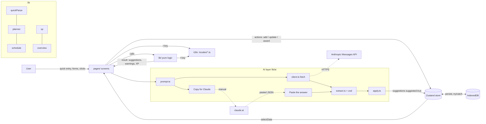

# Architecture

The main idea: **all the smart logic is in pure functions in `src/lib/`** (no React, no browser access), and the React screens only read the state and show the result. That makes the logic easy to test (the same inputs always give the same output).

## Data flow

## Layers

| Layer     | Files                            | Role                                                                                                 |
| --------- | -------------------------------- | ---------------------------------------------------------------------------------------------------- |
| Types     | `src/types.ts`                   | a single source of truth for all data                                                                |
| Languages | `src/i18n/`                      | `t('key')`, translation files in `locales/`, language choice; Serbian Cyrillic is derived from Latin |
| State     | `src/store.ts`, `lib/storage.ts` | Zustand; `persist` into IndexedDB; everything in try/catch                                           |
| Logic     | `src/lib/*.ts`                   | pure functions: parser, planner, grades, XP, ics, reminders                                          |
| AI        | `src/lib/ai/*`                   | prompt → (API or manual) → JSON extraction → `zod` → suggestion                                      |
| UI        | `src/pages`, `src/components`    | React screens and shared elements (`NumberInput` for all numeric fields, `KeyScope` for Enter/Esc)   |
| Tests     | `*.test.ts(x)`, `e2e/`           | Vitest (unit, components), Playwright + axe (e2e)                                                    |

## Languages (i18n)

- **One file = one language.** `src/i18n/locales/*.ts` are discovered automatically (`import.meta.glob`); a file exports `code`, `name`, `dateLocale` (date-fns) and `messages`. The list of keys is `sr-Latn.ts`; TypeScript and a test (`i18n.test.ts`) fail if another language is missing a key or a `{parameter}`.
- **`t(key, params)`** also works outside React, so the pure logic in `lib/` (warnings, planner, prompt) returns text in the chosen language. `useT()` re-renders the screen when the language changes. Plurals: `.one/.few/.other` keys through `Intl.PluralRules`.
- **Internal IDs are not translated.** Categories, types and statuses in the data stay the same (`'kolokvijum'`, `'ne-idem'`...), and only the labels are translated (`lib/labels.ts`). So changing the language does not change the saved data.
- **Default values depend on the language.** An empty reward name and currency mean "the default for the chosen language".

## Data migration

Saved data has a version (`DATA_VERSION`). `migrateData()` in `lib/defaults.ts` turns the old shape into the new one (e.g. `ps5EarnedMin` → `rewardEarnedMin`). It runs when loading from IndexedDB and when importing JSON, it is a pure function and is safe to run more than once.

## Why it is built this way

- **Two AI modes, one code path.** The manual and the API mode share `buildPrompt`, `parseAiResponse` and the display. The only difference is who sends the prompt (me by copying, or `fetch`).
- **AI never changes data directly.** The result becomes a _suggestion_ (`suggested: true`, dashed border) that the user accepts.
- **Validation at the boundary.** Everything that comes from outside (an AI answer, imported JSON) is checked before it touches the store.
- **Idempotent XP.** Every event has an `id`; the same `id` never gives XP twice (`progress.awarded`).
- **Offline.** `vite-plugin-pwa` caches the app; the data is in IndexedDB; only the AI call needs the internet.
- **Keyboard everywhere.** `KeyScope` gives a step, form or dialog Enter (confirm) and Esc (cancel); in a multi-line field Enter makes a new line (confirm is Ctrl+Enter).
- **No server.** That is why notifications are limited (see the README), and the `.ics` export is a fallback.

## Planner (`lib/planner.ts`)

1. For each day: free intervals = the window (wake-up–bedtime) minus what is taken (activities + classes I attend).
2. Choosing the lighter day, shortening a workout on the day before an exam, placing new workouts.
3. Study demand per exam: the hours already done or scheduled (a block remembers its `assessmentId`) are subtracted from the requested hours, and the difficulty decides how many days earlier to start and whether the load is even or grows towards the exam. The sum of the daily shares is always exactly what is needed.
4. Blocks up to 2 h, a 30 min break, first in the "not going" slots, a daily study limit; the surplus carries over to the next day.
5. A reward after the last study block.

`planWeek` is only the order of these steps; each step is a separate function. Examples are in `planner.test.ts`, and `planner.invariants.test.ts` checks the rules that must hold for any week (300 random but repeatable scenarios).
