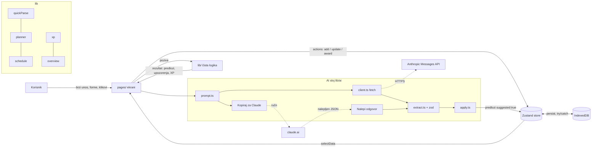

# Arhitektura

Glavna ideja: **sva pametna logika je u čistim funkcijama u `src/lib/`** (bez React-a, bez pristupa pregledaču), a React ekrani samo čitaju stanje i prikazuju rezultat. Zato se logika lako testira (iste ulaze uvek daju isti izlaz).

## Tok podataka

## Slojevi
| Sloj | Fajlovi | Uloga |
|---|---|---|
| Tipovi | `src/types.ts` | jedan izvor istine za sve podatke |
| Stanje | `src/store.ts`, `lib/storage.ts` | Zustand; `persist` u IndexedDB; sve u try/catch |
| Logika | `src/lib/*.ts` | čiste funkcije: parser, planer, ocene, XP, ics, podsetnici |
| AI | `src/lib/ai/*` | prompt → (API ili ručno) → izvlačenje JSON-a → `zod` → predlog |
| UI | `src/pages`, `src/components` | React ekrani i zajednički elementi |
| Testovi | `*.test.ts(x)`, `e2e/` | Vitest (unit, komponente), Playwright + axe (e2e) |

## Zašto ovako
- **Dva AI režima, jedan kod.** Ručni i API režim dele `buildPrompt`, `parseAiResponse` i prikaz. Razlika je samo u tome ko šalje prompt (ja kopiranjem, ili `fetch`).
- **AI nikad ne menja podatke direktno.** Rezultat postaje *predlog* (`suggested: true`, isprekidana ivica) koji korisnik prihvata.
- **Validacija na granici.** Sve što dolazi spolja (AI odgovor, uvezeni JSON) prolazi proveru pre nego što dodirne store.
- **Idempotentan XP.** Svaki događaj ima `id`; isti `id` nikad ne daje XP dvaput (`progress.awarded`).
- **Offline.** `vite-plugin-pwa` kešira aplikaciju; podaci su u IndexedDB; samo AI poziv traži internet.
- **Bez servera.** Zato su notifikacije ograničene (vidi README), a `.ics` izvoz je rezerva.

## Planer (`lib/planner.ts`)
1. Za svaki dan: slobodni intervali = prozor (buđenje–spavanje) minus zauzeto (aktivnosti + časovi koje pohađam).
2. Biranje lakšeg dana, skraćivanje treninga na dan pred ispit, raspoređivanje novih treninga.
3. Potražnja za učenjem po ispitu: težina određuje koliko dana ranije se kreće i da li je ravnomerno ili raste ka ispitu.
4. Blokovi do 2 h, pauza 30 min, prvo u terminima „ne idem", ograničenje dnevnog učenja; višak se prenosi na sledeći dan.
5. Igra kao nagrada posle poslednjeg bloka učenja.
